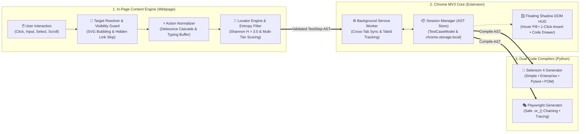

<div align="center">

<!-- Project Title -->
<h1>⚡ Selenium & Playwright AI Test Recorder</h1>

<!-- Animated Typing Banner (Responsive Single-Line Carousel) -->
<a href="https://github.com/venkatesh01-t/chrome-driver">
  
</a>

<p align="center">
  <strong>An Enterprise Chrome Manifest V3 Automation Extension that transforms live browser interactions into 100% flake-free, self-healing Python automation suites — featuring an in-page floating HUD and hover pill with zero side-by-side viewport squashing.</strong>
</p>

<!-- Dynamic Status Badges -->
<p align="center">
  
  
  
  
  
  
</p>

<!-- Deploy with Vercel & Live Showcase Portal -->
<p align="center">
  <a href="https://vercel.com/new/clone?repository-url=https%3A%2F%2Fgithub.com%2Fvenkatesh01-t%2Fchrome-driver" target="_blank" rel="noopener">
    
  </a>
  <a href="https://chrome-driver-extension.vercel.app/" target="_blank" rel="noopener">
    
  </a>
  <a href="https://chrome-driver-extension.vercel.app/llms.txt" target="_blank" rel="noopener">
    
  </a>
</p>

<!-- Navigation Jump Anchors -->
<p align="center">
  <a href="https://chrome-driver-extension.vercel.app/" target="_blank">🌐 Live Showcase Portal</a> •
  <a href="#-why-this-recorder-is-different">Why It's Different</a> •
  <a href="#-system-architecture--data-flow">Architecture</a> •
  <a href="#-zero-side-by-side-split-floating-in-page-hud--hover-pill">Floating HUD</a> •
  <a href="#-deterministic-locator--self-healing-engine">AI Locator Engine</a> •
  <a href="#-4-production-code-generation-modes">Code Outputs</a> •
  <a href="#-quickstart--installation">Quickstart</a> •
  <a href="#-test-verification">Verification</a>
</p>

</div>

---

## 🎯 Why This Recorder Is Different

Traditional browser recorders dump brittle absolute XPaths (`/html/body/div[2]/div/button[1]`) or dynamic framework hashes (`id=":r0:"`, `class="css-1dbjc4n"`) directly into flat scripts that break on the very next page reload. Furthermore, conventional side panels squeeze the browser window into mobile viewports, breaking responsive layouts.

**`chrome-driver` (`Selenium & Playwright Python Test Recorder`)** is engineered around a **Closed-Loop Deterministic AST Pipeline** with a **Non-Intrusive Floating In-Page HUD**:

| Capability | Standard Recorders (Selenium IDE / Raw Codegen) | ⚡ `chrome-driver` (This Engine) |
| :--- | :--- | :--- |
| **Viewport Layout** | Forced side-by-side split → breaks desktop layouts into mobile | **100% Desktop Viewport (1920x1080)** → Zero side-by-side split |
| **Recorder UI** | Rigid 500px sidebar squashing the webpage | **Draggable Floating HUD** with auto-collapsing **Hover Pill Widget** |
| **Dynamic IDs** | Blindly records `:r0:`, `css-19b`, UUIDs → Breaks on next reload | **Shannon Entropy & Regex Filter** automatically rejects unstable tokens |
| **Table Actions** | Uses brittle positional index `(//button)[4]` | **Contextual Row Anchoring** (`//tr[contains(.,'User')]//button[.='Approve']`) |
| **Runtime Fallback** | Crashes with `NoSuchElementException` / strict mode violation | **3-Tier Self-Healing** (`smart_find` / `.locator("visible=true").first`) |
| **Shadow & Iframes** | Fails to pierce encapsulated DOM roots | **Multi-Level `composedPath()` Piercing** & Auto Frame Switching |
| **Wait Strategy** | Hardcoded `time.sleep()` or `implicitly_wait()` | **100% Explicit Waits (`WebDriverWait` + `EC`)** + Overlay Spinners Guard |
| **Code Outputs** | Single flat script | **4 Modes:** `Simple`, `Enterprise`, `Pytest`, and **Page Object Model (POM)** |
| **Secret Safety** | Hardcodes sensitive passwords in cleartext | **Automatic `os.getenv("TEST_PASSWORD")`** and `TEST_DATA` dictionary |

---

## 🏗️ System Architecture & Data Flow

The extension is designed around a decoupled, 3-tier event pipeline that separates **DOM Perception**, **AST State Management**, and **Code Compilation**:



### 🔄 End-to-End Event Lifecycle

```text
User Action (Click / Keypress)
  │
  ▼ [Layer 1: In-Page Content Engine]
  ├─► composedPath() Normalization  ──► Walks up from SVG/icons to semantic interactive control
  ├─► Visibility Guard Check         ──► Discards hidden anchors (<a hidden>), display:none, opacity:0
  ├─► Shannon Entropy Filter         ──► Strips dynamic hashes (:r4f:, ng-tns, UUIDs)
  ├─► Contextual Locator Generation  ──► Emits 3-tier ranked locators (TestID > ARIA > Text > XPath)
  │
  ▼ [Layer 2: Chrome MV3 Core]
  ├─► Action Normalizer              ──► Coalesces rapid typing & debounces synthetic event bursts (<400ms)
  ├─► Tab Switch Tracking            ──► Detects target="_blank" navigations & emits switch_tab
  ├─► Session AST Persistence        ──► Serializes structured TestStep into chrome.storage.local
  │
  ▼ [Layer 3: Dual Code Generators]
  ├─► AST-to-Selenium Synthesizer    ──► Emits WebDriverWait + 3-tier smart_find() self-healing fallbacks
  └─► AST-to-Playwright Synthesizer  ──► Emits .locator("visible=true").first strict-mode safe chains
```

### 🧩 3-Layer Architecture Breakdown

| Architecture Layer | Key Responsibilities | Source Files |
| :--- | :--- | :--- |
| **1. In-Page Perception** | Listens in capture phase, resolves true interactive targets from raw DOM leaves, rejects dynamic entropy noise, generates contextual XPaths, and renders the in-page Floating HUD. | [`src/content/`](file:///c:/Users/KING/Documents/GitHub/chrome-driver/src/content/)<br/>`event-recorder.ts`<br/>`locator-engine.ts`<br/>`action-normalizer.ts`<br/>`hud/` |
| **2. Chrome MV3 Core** | Manages session lifecycle, tracks active tabs across multiple windows, synchronizes recording state across navigations, and persists test cases to local extension storage. | [`src/background/`](file:///c:/Users/KING/Documents/GitHub/chrome-driver/src/background/)<br/>`service-worker.ts`<br/>`session-manager.ts` |
| **3. Multi-Engine Compilers** | Pure TypeScript AST compilers that transform `TestCaseModel` JSON into four distinct Python testing paradigms for Selenium 4 and Playwright. | [`src/generator/`](file:///c:/Users/KING/Documents/GitHub/chrome-driver/src/generator/)<br/>`python-generator.ts`<br/>`playwright-generator.ts` |

---

## 🪟 Zero Side-by-Side Split: Floating In-Page HUD & Hover Pill

Unlike typical recorder tools that split the Chrome window into a cramped side-by-side view (breaking responsive web layouts and triggering unwanted mobile hamburger menus), this extension runs as an **encapsulated in-page Floating HUD toolbar**:

```text
+---------------------------------------------------------+
|  100% FULL DESKTOP VIEWPORT (Zero Side-by-Side Split)   |
|                                                         |
|  https://target-app.com/dashboard                       |
|                                                         |
|  +--------------------+   +---------------------------+ |
|  | Web Application    |   | FLOATING RECORDER HUD     | |
|  | (1920x1080 canvas) |   | [🔴 REC 00:24] [12 Steps] | |
|  | No squeezed menus! |   | [💬 Assert] [📋 Code] [➖]| |
|  +--------------------+   +---------------------------+ |
|                                       | (Hover away)    |
|                                       v                 |
|                               +---------------+         |
|                               | 🔴 REC (12)   | <--Pill |
|                               +---------------+         |
+---------------------------------------------------------+
```

### Key HUD Capabilities
1. **Isolated Shadow DOM Root (`<automatex-recorder-hud>`):** Open Shadow Root with completely encapsulated CSS. Page CSS cannot bleed into the recorder, and recorder styles never alter the website.
2. **Auto-Collapsing Hover Pill Widget:** Collapses to a compact 40px glowing floating pill (`🔴 REC 12`). Hovering expands the full control bar; mouse leave smoothly collapses it after 500ms.
3. **Draggable with Persistent Positioning:** Freely drag the widget anywhere on screen. Position coordinates persist automatically across tab switches and page navigations.
4. **1-Click QA Assertion Mode:** Click `💬 Text`, `👁 Visible`, or `🖨 Print Val` directly on the HUD toolbar; the next clicked DOM element automatically records an assertion step.
5. **Slide-Over Floating Code Drawer:** Inspect generated code on the fly without resizing the webpage. Switch between Selenium 4 and Playwright, toggle code styles, copy to clipboard, or download `.py` files.

---

## 🔍 Deterministic Locator & Self-Healing Engine

### 1. Mathematical Shannon Entropy & Noise Filter
Dynamic strings generated by modern UI libraries (React 18 `useId` e.g. `:r4f:-input-894723`, Angular `ng-tns-c123`, Tailwind, or random UUIDs) are detected and filtered:
- **Shannon Entropy Calculation:** High-entropy token detection ($H > 3.0$) with character-class transition rate analysis.
- **Natural Language Protection:** Human-readable multi-word identifiers (`cost-center-code`, `username`, `profile-avatar`) are preserved with zero false positives.

### 2. Multi-Attribute Element Fingerprinting
Every recorded step stores a detailed `ElementFingerprint`:
```typescript
interface ElementFingerprint {
  tagName: string;
  text?: string;
  ariaRole?: string;
  ariaLabel?: string;
  name?: string;
  placeholder?: string;
  rowContext?: string;
  labelText?: string;
}
```
At runtime, `scoreElementSimilarity` evaluates candidates on a deterministic `0.0` to `1.0` scale to self-heal locators if class names or minor attributes change.

### 3. Contextual Row & Label Anchoring
- **Table Row Anchoring:** When action buttons (e.g. `Approve` or `Revoke`) share identical text across multiple table rows, the locator engine anchors the button to unique row text:
  ```xpath
  //tr[contains(., 'Bob Smith')]//button[normalize-space()='Approve']
  ```
- **Label-Anchored Form Inputs:** Inputs lacking unique static IDs anchor to their preceding visual `<label>`:
  ```xpath
  //label[normalize-space()='Cost Center Code']/following::input[1]
  ```

### 4. Interactive Target Bubbling & Shadow DOM Traversal
- **Decorative Leaf Bubbling:** Clicks on inner `<svg>`, `<path>`, `<span>`, or `<i>` tags walk up `event.composedPath()` to resolve the parent semantic control (`<button aria-label="Notifications">`).
- **Visibility-Aware Selection:** Resolvers filter out hidden jump links and inaccessible DOM nodes, preventing Playwright strict mode or timeout issues.
- **Multi-Level Shadow DOM Chains:** Deeply nested web components produce chained shadow root traversals in generated Python code:
  ```python
  curr_root = driver
  for h_sel in ['gt-ess-portal', 'gt-attendance-widget']:
      h_el = wait.until(EC.presence_of_element_located((By.CSS_SELECTOR, h_sel)))
      curr_root = h_el.shadow_root
  element = curr_root.find_element(By.CSS_SELECTOR, "#shadow-swipe-btn")
  ```

---

## 🐍 4 Production Code Generation Modes

Export clean, idiomatic Python code for both **Selenium 4** and **Playwright**:

### 1. Enterprise Mode (CI/CD Ready)
- Headless execution toggle: `HEADLESS=true python test.py`
- Overlay Guard: automatically waits for transient spinners (`[aria-busy="true"]`, `.loading-overlay`) to clear before clicking.
- Automatic failure diagnostics: timestamped screenshot and DOM snapshot saved to `artifacts/` on error.
- Sensitive credentials hoisted to `os.getenv("TEST_PASSWORD")`.
- Input values hoisted into a structured `TEST_DATA = { ... }` dictionary.

### 2. Simple Mode (Zero-Boilerplate)
- Concise 30–50 line script with integrated `smart_find` and `smart_click` helpers.
- Automatic scrolling and JavaScript click fallback (`arguments[0].click()`).

### 3. Pytest Mode
- Native Pytest fixture architecture (`@pytest.fixture def driver(): ...`).
- Clear test assertions with parameterization support.

### 4. Page Object Model (POM) Mode
- Generates a modular Page Object class encapsulating locator constants and semantic snake_case action methods:
  ```python
  class DemoAppPage:
      LOCATOR_FILL_WORK_EMAIL = [(By.ID, "work-email"), (By.NAME, "email")]
      LOCATOR_CLICK_SAVE_ACCOUNT_INFO = [(By.ID, "save-btn"), (By.XPATH, "//button[.='Save']")]

      def fill_work_email(self, value):
          el = self.smart_find(self.LOCATOR_FILL_WORK_EMAIL)
          el.clear()
          el.send_keys(value)

      def click_save_account_info(self):
          self.smart_click(self.LOCATOR_CLICK_SAVE_ACCOUNT_INFO)
  ```

---

## 🛠️ Quickstart & Installation

### 1. Build Extension
```bash
# Install dependencies
npm install

# Compile TypeScript and bundle with Vite
npm run build
```

### 2. Load Extension in Chrome
1. Navigate to `chrome://extensions/` in Google Chrome.
2. Enable **Developer mode** (toggle in the top-right corner).
3. Click **Load unpacked** and select the `dist/` directory from this repository.
4. Click the extension toolbar icon on any page to open the **Floating In-Page HUD** (or access the Side Panel if desired).

---

## 🧪 Test Verification

### 1. Run Unit & Integration Suites (Vitest)
```bash
npm test
```
**Current Test Status:** `12 passed out of 12 test files (122 tests passed, 0 failures)`.

### 2. Run Live Chrome End-to-End Testbed
```bash
# Install Python test dependencies
pip install -r requirements.txt

# Run complete 4-stage live Chrome automation verification
python tests/live_chrome_test.py
```

### 3. Run Multi-Tab & Torture Execution
```bash
# Headless live execution against real web applications
$env:HEADLESS="true"; python test.py
```

---

## 📁 Repository Structure

```
chrome-driver/
├── manifest.json              # Chrome Manifest V3 definition
├── package.json               # Node dependencies & Vite/Vitest configs
├── requirements.txt           # Python dependencies (Selenium 4, Playwright, Pytest)
├── src/
│   ├── background/            # Service worker & session manager (AST store)
│   ├── content/               # Event recorder, action normalizer, locator engine & validator
│   │   └── hud/               # Shadow DOM Floating HUD & Hover Pill Widget (CSS + Manager)
│   ├── generator/             # Python Selenium 4 & Playwright code generators
│   ├── sidepanel/             # Optional Side Panel UI & controller
│   ├── types/                 # TypeScript models (TestStep, ElementFingerprint, Messages)
│   └── utils/                 # DOM helpers and string escape utilities
├── tests/                     # 12 Vitest suites & Python live verification scripts
└── test-pages/                # Demo torture testbed (Shadow DOM, iframes, entropy traps)
```

---

## 📄 License
MIT License. Built for modern QA engineers and test automation architects.
