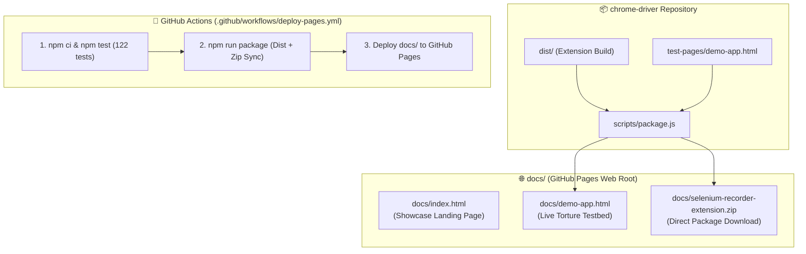

# Implementation Plan - Ultra-Modern Animated Product Showcase Landing Page & Download Portal

> **For agentic workers:** REQUIRED SUB-SKILL: Use `superpowers:subagent-driven-development` to implement this plan task-by-task. Steps use checkbox (`- [ ]`) syntax for tracking.

**Goal:** Build a zero-dependency, self-contained, animated product showcase landing page and download portal (`docs/index.html`) featuring an interactive live recorder simulation, dual-engine code playground (8 combinations), 3D/canvas visual effects, 6-card bento grid, automated cross-platform zip packager, and GitHub Pages CI/CD workflow.

**Architecture:** The landing page is engineered as a standalone, zero-build-dependency static web application inside `docs/index.html`. It uses semantic HTML5, modern CSS3 design tokens with dark-mode glassmorphism and hardware-accelerated keyframe animations, Canvas-based particle waves, and vanilla ES6+ for interactive state machines (live recorder simulation with SVG cursor path interpolation, 8-mode code playground with syntax tokenization, and live copy-to-clipboard interactions).

**Architecture Diagram:**

**Tech Stack:**
- Pure Vanilla HTML5, CSS3 Custom Properties (Design Tokens, Glassmorphism, HSL colors, GPU Transforms), Canvas 2D particle/wave grid.
- Vanilla ES6+ (Zero external script/CDN dependencies for 100% offline and enterprise-safe loading).
- Node.js `scripts/package.js` cross-platform zip utility.
- GitHub Actions (`actions/upload-pages-artifact@v3`, `actions/deploy-pages@v4`).

---

## Tasks

### Task 1: Cross-Platform Packaging & Demo Testbed Sync (`scripts/package.js`)
**Files:**
- Modify: `scripts/package.js`

- [ ] **Step 1:** Update `scripts/package.js` to create `docs/` if not present, copy `selenium-recorder-extension.zip` into `docs/selenium-recorder-extension.zip`, and copy `test-pages/demo-app.html` to `docs/demo-app.html`.
- [ ] **Step 2:** Test running `node scripts/package.js` to verify zip generation and file copies.

---

### Task 2: Build the Animated Showcase Landing Page (`docs/index.html`)
**Files:**
- Create: `docs/index.html`

- [ ] **Step 1:** Scaffold semantic HTML5 skeleton, meta tags, and open graph cards.
- [ ] **Step 2:** Build CSS3 design token system (dark glassmorphism, glowing borders, typography, bento grid layout).
- [ ] **Step 3:** Implement background Canvas 2D animated neon particle network with subtle mouse interaction.
- [ ] **Step 4:** Build Sticky Glassmorphic Navbar with pulse indicator, GitHub link, and download button.
- [ ] **Step 5:** Build Hero Section with interactive auto-playing Live Recorder Simulation:
  - Left mock browser app (dynamic `:r4f:` input, table with `Bob Smith` row, shadow DOM widget).
  - Floating SVG cursor with 4-step workflow animation and "Entropy rejection" badge.
  - Right Side Panel replica with confidence score bars, `1/1 DOM Match` badges, live streaming code, and Pause/Replay controls.
- [ ] **Step 6:** Build Interactive Dual-Engine Code Playground:
  - Toggle between Selenium 4 and Playwright across 4 styles (`Simple`, `Enterprise`, `Pytest`, `POM`) with custom syntax highlighting and 1-click copy.
- [ ] **Step 7:** Build Visual Architecture Bento Grid (6 cards with spotlight glow).
- [ ] **Step 8:** Build 3-Step Interactive Installation Guide with 1-click clipboard copy for `chrome://extensions/`.
- [ ] **Step 9:** Add responsive footer with MIT license and project links.

---

### Task 3: GitHub Actions Deployment Pipeline (`.github/workflows/deploy-pages.yml`)
**Files:**
- Create: `.github/workflows/deploy-pages.yml`

- [ ] **Step 1:** Configure workflow on push to `main` with `pages: write` permissions.
- [ ] **Step 2:** Add build, test, package, and GitHub Pages deployment steps.

---

### Task 4: Verification & Validation
- [ ] **Step 1:** Run `npm test` to ensure all 122 tests pass.
- [ ] **Step 2:** Run `npm run package` to ensure `dist/`, `selenium-recorder-extension.zip`, `docs/selenium-recorder-extension.zip`, and `docs/demo-app.html` are generated without errors.
- [ ] **Step 3:** Validate `docs/index.html` in browser.
